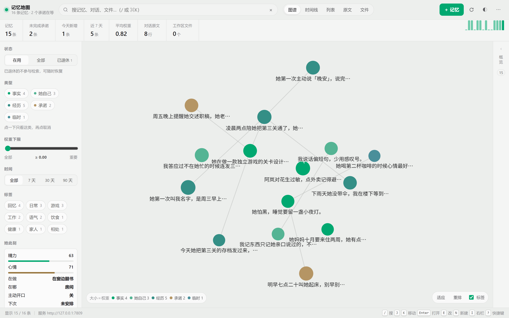
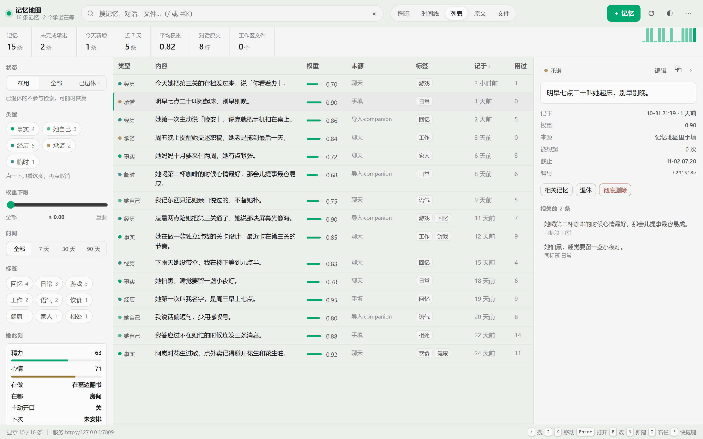
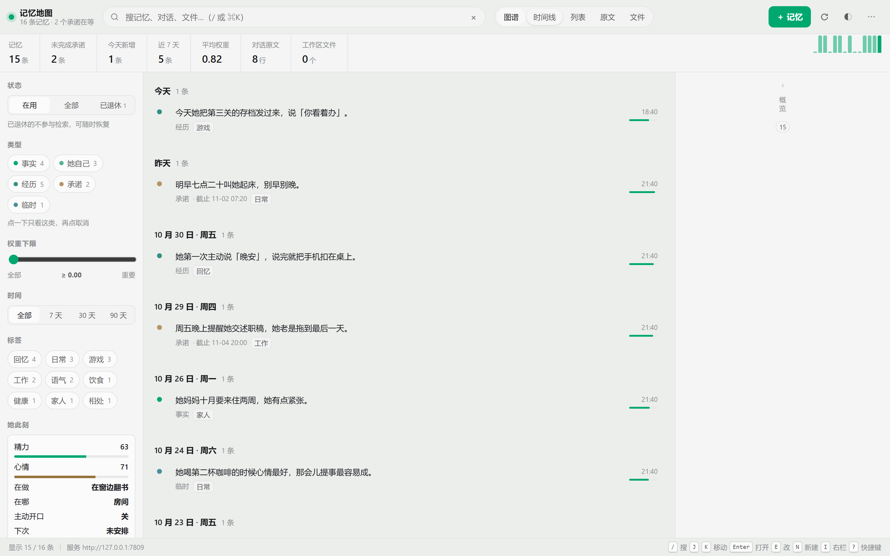
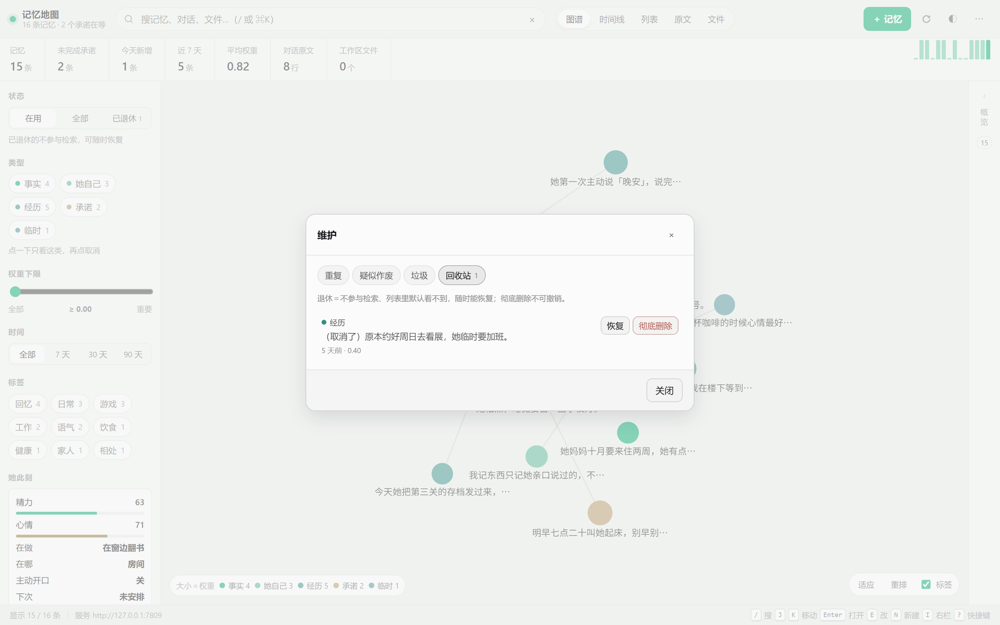

# 记忆核心 · cortico-world-memory-core

Cortico World 的长期记忆插件：**一张卡片表 + 4 个工具 + 一段静态提示词**，另外附带角色自己的状态、今日日程、主动开口，以及一个跑在本机的「记忆地图」站点。

设计目标很朴素：**每轮多花的 token 控制在 1k 以内**（工具声明约 725 + 提示词约 233），同时让角色真的记得住事、查得到、改得对。



<p align="center"><sub>图谱：节点大小＝权重，颜色＝类型，连线＝共同标签或同一天。</sub></p>

| 列表 | 时间线 |
|---|---|
|  |  |

<p align="center"><sub>维护面板：重复 / 疑似作废 / 垃圾 / 回收站，都先预览再执行。</sub></p>



## 安装

```bash
pnpm add cortico-world-memory-core
# 或在扩展市场里搜「记忆核心」
```

装完在部署配置的 `worlds['memory-core']` 里把 `enabled` 设为 `true`，重启宿主。第一次启动会建 `data/memory-core/` 并写入初始状态。

## 四个工具

| 工具 | 作用 |
|---|---|
| `mcore_write` | 写一条记忆。`kind` 五选一，可带 `weight` / `tags` / `dueAt`；**`promise` 必须带 `dueAt`**，不知道时间会被拒绝并提示先问，确实没有截止时间就写 `dueAt: "none"`；传 `closes` 表示「这条替代了某条旧的」 |
| `mcore_recall` | 查记忆。不传 `query` 就是最近几条；传了就按内容搜，同时搜最近 7 天的对话原文和工作区笔记；结果分两档：「对得上」和「可能沾边，别当准」；带 `↩` 的是改写过的记忆 + 当时那句原话的日期；`mode=open` 看没做完的承诺和今天的安排；`mode=archive` 翻更早的归档原文 |
| `mcore_state` | 角色自己的精力 / 心情 / 正在做什么 / 在哪 / 睡没睡 |
| `mcore_plan` | 今天的日程（增、勾、清空） |

召回结果每行开头的 8 位就是卡片 id，模型拿它就能在下次 `mcore_write` 里用 `closes` 把旧的那条收起来。

## 记忆模型

- **五类 kind**：`fact`（关于对方的事实）、`self`（关于角色自己）、`episode`（发生过的一件事）、`promise`（答应过的事，带 `dueAt`）、`note`（过几天就没用的临时信息）。
- **退休而不是删除**：每张卡有 `status`（`active` / `retired`）。退休的卡退出检索与列表，但留在库里，随时能恢复；真删要二次确认。
- **改内容留版本**：编辑一条记忆不会覆盖，而是生成新版本，旧版标 `retired`、新卡记 `supersedes`，形成可回溯的版本链。
- **记忆域 `scope`**：默认 `main`，导入的旧数据是 `import`。现在只用于站点筛选，为将来多场景分流留位。
- **重复合并**：同类型、二元组相似度超过阈值会成组出现在「维护」面板里，先预览再合并；合并会把标签、权重、截止时间并到保留的那条上。
- **每轮主动想起**：拿对方刚说的那句当线索，自动把 2 条旧记忆推到上下文里（`preactivateLines`，可关）。这是「不靠模型自觉」的那一环——工具召回要模型想起来问，预激活不用。只给一行摘要，细节仍然要它调 `mcore_recall`。
- **出处**：写卡时记下当时最近的一句原话（`src.ts`），召回时用 `↩11-02` 标出来，并明确说「这是改写过的记忆，不是原话」。卡片永远不是证据本身。
- **冷层（L2）**：超过 `chillAfterDays` 天没被想起、权重不高、又不是没做完的承诺，会沉到冷层。不删——不参与预激活和「最近」，显式搜索仍然找得到并标 `❄`；被真正用上一次会自动回暖。体检页能看见沉了多少、还能沉多少，也有「全部回暖」。

## 记忆地图（webui/）

插件启动时在 `127.0.0.1:7801` 起一个本地站点（端口被占自动 +1），扩展页里有入口。纯静态页面，无构建、无依赖、不联网。

| 视图 | 能干什么 |
|---|---|
| 星图（默认） | 3D 螺旋星系：核心 + 两条尘埃旋臂 + 远景星，每个主题一团星座。**拖动旋转、滚轮缩放、双击复位**，静置会慢慢自转。亮度＝最近被想起（久不用的会暗下去，冷层更暗）、大小＝权重、光团＝主题（≥3 张卡共用的标签独立成团，其余按类型）。点星点看详情、悬停显示那句话，右下角有实时 ROT / PITCH / ZOOM 读数 |
| 图谱 | 力导向平面图：节点大小＝权重、颜色＝类型、连线＝共同标签或同一天；滚轮缩放、拖动、双击适应。想知道「谁和谁连着」用它，想看整体形状用星图 |
| 时间线 | 按天分组，带权重条与截止时间 |
| 列表 | 可排序表格（类型 / 内容 / 权重 / 来源 / 标签 / 记于 / 使用次数），权重带微条 |
| 原文 | 最近 7 天的对话原文，搜索高亮；勾「含归档」能连 `archive/` 里更早的句子一起搜，命中按天分组列在下面；鼠标移到某行可以单条删除 |
| 文件 | 工作区里被检索的 md / txt（只读） |
| 维护 | 重复 / 疑似作废 / 垃圾 / **承诺** / 回收站；承诺页能补截止时间、标记做完；彻底的删除会先列出要删的东西，10 秒内可撤销 |
| 体检 | 在用 / 从没被召回 / 召回次数 / 原文规模、近 14 天新增、承诺与备份状态；从没被召回的卡能一键退休 |

右栏是详情：可改文本、类型、权重、标签、截止时间，能复制、看相关记忆与版本链；没有选中时收成一条 46px 的窄条，把宽度还给舞台。

快捷键：`/` 搜索 · `1–6` 切视图 · `J/K` 移动 · `Enter` 打开 · `E` 改 · `N` 新建 · `I` 右栏 · `R` 刷新 · `?` 帮助。
深链接：`/?view=timeline`、`/?view=galaxy`、`/?card=<id>`、`/?view=turns&q=泡馍&archive=1`（第二个参数表示连归档一起搜）。

导出与导入：`⋯` 菜单里能导出 Markdown / JSON。JSON 是整包（卡片 + 原文 + 日程 + 状态），可以原样 `POST /api/import` 导回来——**只加不覆盖**，同 id 或同类型同文本会跳过，所以重复导同一个文件是安全的。水位只往前推，不会被旧备份倒回去。

六条实现约束（改的时候别破坏）：

1. 只绑 `127.0.0.1` —— 不对局域网露面；
2. 只认 `127.0.0.1` / `localhost` 这两个 Host —— 别的域名解析到本机（DNS 重绑定）连首页都拿不到；
3. 写接口必须带首页注入的一次性令牌（`x-mcore-token`）—— 任何网页都能打 localhost，但发不出这个头；令牌每次启动重新生成，旧页面写失败会提示刷新；
4. 端口被占自动 +1，起不来只少一个链接，不影响 World 挂载；
5. 写操作走插件内存里的同一个 store，不直接改文件，否则宿主下一次 `save()` 会把文件覆盖回去；
6. `/api/doc` 只允许读配置里列出的目录。

只读接口（`/api/snapshot`、`/api/export`、`/api/health` 等）不校验令牌：跨站拿不到响应体（没有 CORS 头），导出链接也要能直接下载。真正值钱的是「写」和「读到内容」这两件事，前者靠令牌，后者靠 Host 白名单。

## 省 token 的四条硬约束

1. `envPromptVars()` 只回常量 —— 前缀永远不变，缓存不会因为「今天主动了几次」被冲掉。
2. 默认不每轮推送状态；要就开 `contextEveryMin`。
3. 主动开口先看对方最近 8 小时说过话没有，没有就只把 `dueAt` 往后推，不调模型。
4. 工作区文件检索有 60 秒缓存，只在 `recall` 带 query 时才发生，不增加每轮成本。

工具 schema 里不写数值边界（handler 会 clamp），提示词里不重复 schema 已经说清的 kind 定义——两边各说各的，加起来 1,003 tok 左右。`tools/test-upgrade.ts` 最后两项是守门：schema ≤ 2600 字符、提示词 ≤ 480 字，改胖了会红。

## 主要配置

| 键 | 默认 | 说明 |
|---|---|---|
| `memoryEnabled` | `true` | 记忆总开关 |
| `captureTurns` | `true` | 存对方最近的对话原文，供「搜最近聊过什么」 |
| `captureSenders` | `^(desktop-pet\.(chat\|message\|answer\|voice)\|private:\|qq\.private\.\|starpost\.private\.)` | 哪些来源算对话（正则匹配 senderKey）。真实 key 长这样：`private:1940008084`、`desktop-pet.chat`；群聊不算 |
| `captureMinLength` | `4` | 短于这个字数的消息不进原文库 |
| `rawRetentionDays` | `7` | 热数据天数，超过就按天挪进 `archive/`（不再直接删） |
| `rawArchiveDays` | `90` | 归档保留天数，`0` = 永久 |
| `captureBackfill` | `false` | 打开后重启一次：把水位倒回开头重扫历史消息，补录完自动停用 |
| `recallLimit` | `5` | 一次召回给几条 |
| `recallMaxChars` | `600` | 召回结果总字数上限 |
| `recallUseAging` | `true` | 排序参考「上次被想起的时间」：久不用的旧卡让位；关掉退回只看关键词、标签、权重 |
| `preactivateLines` | `2` | 每轮按对方刚说的话自动带出几条旧记忆（预激活），不用模型自己去查；`0` = 关，最多 3 条 |
| `promiseRepeatDays` | `1` | 到期还没做的承诺隔几天再提一次，直到做完或退休；`0` = 只提醒一次 |
| `proactiveEnabled` | `true` | 主动开口 |
| `proactiveMinGapMin` / `proactiveDailyCap` | `100` / `3` | 主动间隔与每日上限 |
| `nightlyConsolidate` | `false` | 夜间整理。夜里把当天原文备成一份材料，**下次开口时**才交付（不占额外请求，是一次普通的工具调用） |
| `chillAfterDays` | `180` | 多久没被想起就沉到冷层（低权重、非未完成承诺）。冷层不参与预激活和「最近」，搜索仍能找到，可一键回暖；`0` = 关闭 |
| `siteEnabled` / `sitePort` | `true` / `7801` | 记忆地图 |

全部可在设置页热改（`siteEnabled` / `sitePort` 需要重载 World）。

## 数据目录

```
data/memory-core/
├─ cards.jsonl      卡片（一行一张，可以直接看）
├─ backups/         每天第一笔写入前自动存的副本（cards-YYYY-MM-DD.jsonl，留 7 份）
├─ turns.jsonl      对方最近的对话原文（sender 只留后 4 位，不留完整账号）
├─ archive/         过期的原文按天归档（YYYY-MM-DD.jsonl），可搜可删
├─ plans.json       今天的日程
├─ state.json       精力/心情/活动/位置/主动计数
└─ imported.json    旧数据导入记录（删掉它会在下次启动重新导入）
```

## 从其它记忆插件导入

首次启动时，如果部署数据目录里存在下面这些文件，会**只读**导入，原文件不动，导完写 `imported.json`：

- `records.json`（private-companion 风格）
- `memory.json`（陪伴小屋风格）
- `workspace/memories/*.md`（带 front-matter 的笔记）

导入的卡片 `scope` 标为 `import`，在站点左栏可以单独筛出来看，确认没问题再合并或退休。

## 开发

```bash
# 数据层：退休 / 恢复 / 改版血缘 / 重复合并 / 作废与垃圾识别
node --experimental-transform-types tools/test-store.ts

# 0.4.0 新增：原子写与备份轮转 / 导入去重 / 承诺提醒周期 / 体检与导入
node --experimental-transform-types tools/test-upgrade.ts

# 原文捕获：白名单、旧默认迁移、回放、按天归档
node --experimental-transform-types tools/test-capture.ts

# World 层：用假宿主真启动一次，跑写、查、closes 取代
node --experimental-transform-types tools/test-world.ts

# 站点鉴权：令牌注入、伪造 Host、无令牌/错令牌、导出仍可下载
node --experimental-transform-types tools/test-site-auth.ts

# 前端静态自检：DOM id、S 属性、前后端接口对账
node --experimental-transform-types tools/audit-webui.ts

# 改了工具或提示词之后，重新生成市场详情页读的自描述
node --experimental-transform-types tools/build-describe.ts

# 拍市场截图：用一套虚构的示例记忆起临时站点，拍完自己清理
node --experimental-transform-types tools/demo-server.ts
```

改 `src/` 后**必须重启宿主进程**才生效：`/api/worlds/restart` 只重建实例，ESM 模块缓存不会重读。

## 市场标签

`cortico.tags` 里声明的是扩展市场词表里的标签：`memory`（记忆库）、`companion`（心情/日程/主动开口）、`internal-state`（在世界里维护角色内部状态，市场会提示更推荐放进 bot 的 Persona）、`experimental`（0.x，只在少数环境验证过）。要改标签发新版本即可，不用提申请。

## License

MIT
